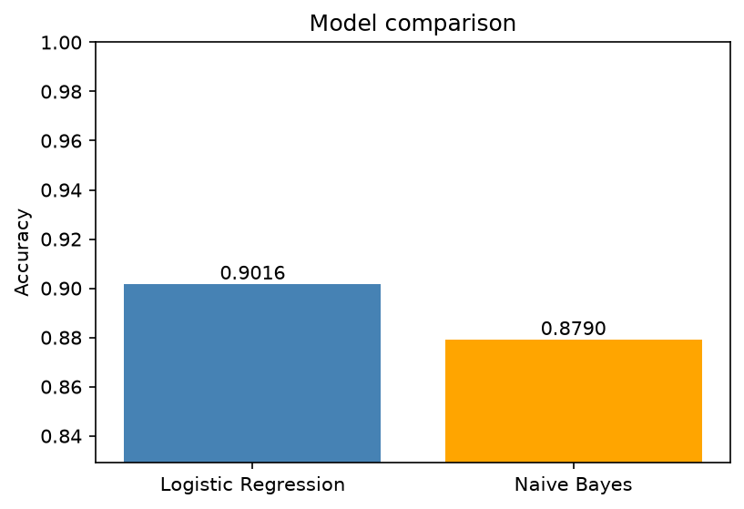
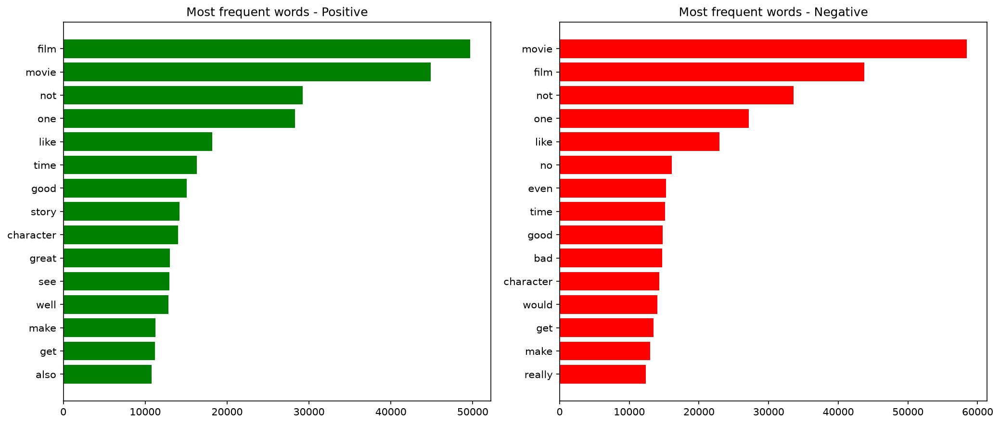

# Task 1: Sentiment Analysis on Movie Reviews

This is my solution for Task 1 of the Elevvo NLP internship.

I trained a model that reads a movie review and says if it is positive or negative. I used the [IMDB 50K reviews dataset](https://www.kaggle.com/datasets/lakshmi25npathi/imdb-dataset-of-50k-movie-reviews) from Kaggle. It has 50,000 reviews, half positive and half negative.

## What I did

1. Loaded the data with Pandas.
2. Cleaned the text. I made everything lowercase, removed HTML tags like ` `, and removed anything that is not a letter.
3. Split each review into words with NLTK (`word_tokenize`).
4. Removed stopwords with NLTK. I kept words like "not" and "no" on purpose, because without them "not good" becomes "good".
5. Lemmatized the words with NLTK (`WordNetLemmatizer`), so "movies" becomes "movie".
6. Split the data into 80% for training and 20% for testing.
7. Turned the text into numbers with TF-IDF (20,000 features), using single words and pairs of words.
8. Trained a Logistic Regression model.
9. Tested it on the 10,000 reviews it had never seen.

## Results

| Model               | Accuracy |
|---------------------|----------|
| Logistic Regression | 90.16%   |
| Naive Bayes         | 87.90%   |

For Logistic Regression, 4463 negative and 4553 positive reviews were correct. 537 negative reviews were predicted as positive, and 447 positive reviews were predicted as negative.

I also tried Naive Bayes as the bonus. It was about 2.3 percentage points lower, and it missed more of the negative reviews. I would use Logistic Regression here because it is more accurate and I can look at which words it cares about.

## Most frequent words

The most frequent words are almost the same in both classes. "film", "movie", "not" and "one" are at the top for positive and for negative reviews, so this plot does not tell me much about the sentiment.

## Most important words

So I plotted the words with the biggest weights in the model instead. Positive: great, excellent, perfect, wonderful, amazing. Negative: worst, bad, awful, waste, boring.

## Things I noticed

- "This movie was not good at all" was predicted as negative, so keeping "not" was the right choice.
- "The plot was okay but nothing special" was predicted as negative with high confidence. The model only learned two classes and "nothing" is a strong negative word for it, so it has no way to say "neutral".

## How to run

1. Download `IMDB Dataset.csv` from the Kaggle link above and put it in the same folder as the notebook (it is not in this repo because it is big).
2. Install the libraries: `pip install -r requirements.txt`
3. Open `task1_sentiment.ipynb` and run all the cells. The NLTK data is downloaded automatically.

Tools: Python, Pandas, NLTK, Scikit-learn, Matplotlib