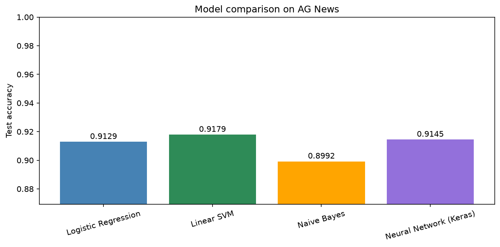
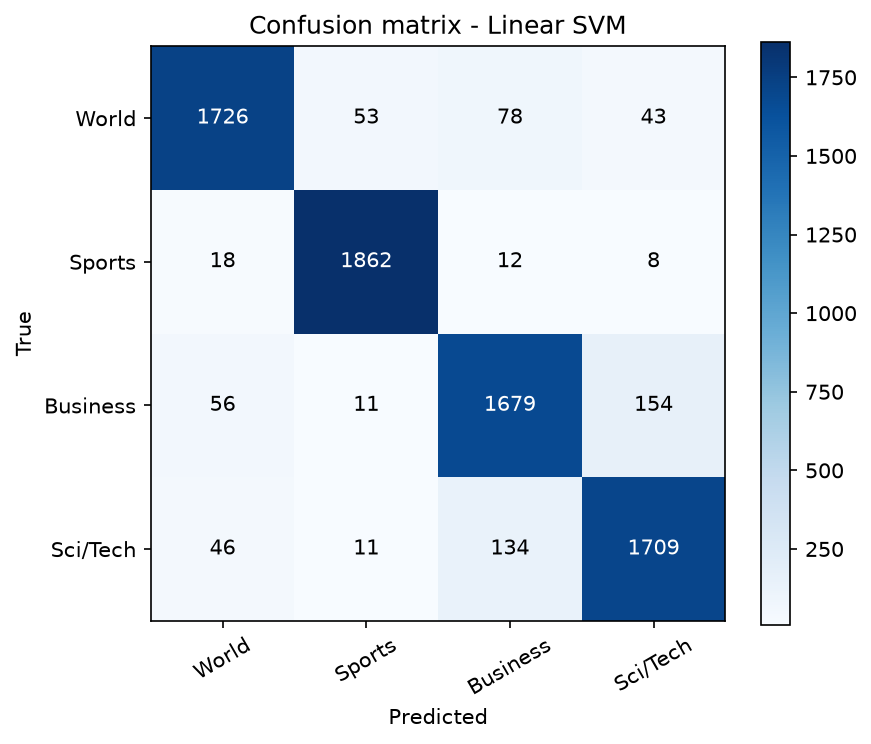
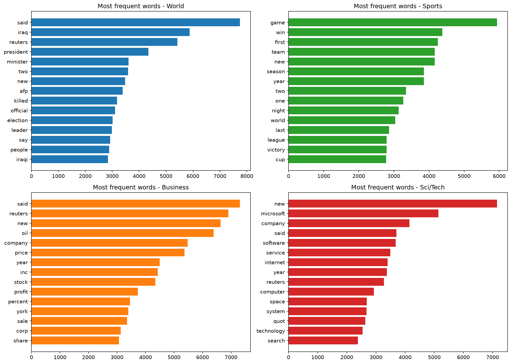
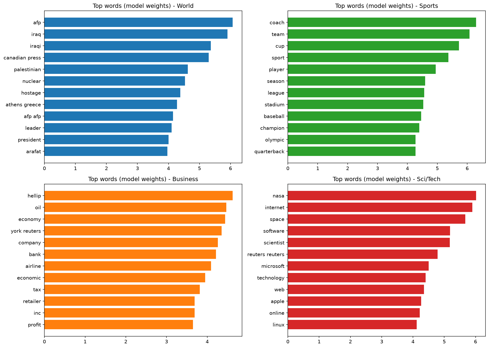
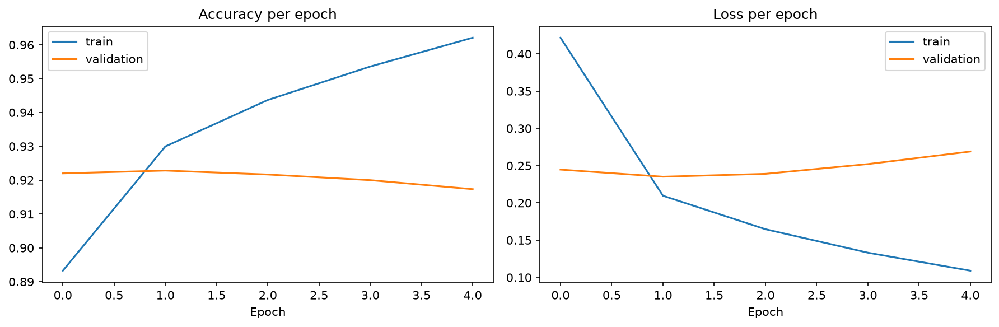

# Task 2: News Category Classification

This is my solution for Task 2 of the Elevvo NLP internship.

I trained models that read a news article and say which category it belongs to. I used the [AG News dataset](https://www.kaggle.com/datasets/thedevastator/new-dataset-for-text-classification-ag-news) from Kaggle. It has news articles in 4 categories: World, Sports, Business and Sci/Tech. I used `<<TRAIN_SIZE>>` articles for training and `<<TEST_SIZE>>` for testing.

Note: AG News has no separate "politics" category. Political news is inside the **World** category.

## What I did

1. Loaded the data with Pandas.
2. Cleaned the text. I made everything lowercase, fixed HTML codes, and removed anything that is not a letter.
3. Split each article into words with NLTK (`word_tokenize`).
4. Removed stopwords with NLTK, and also very short words (2 letters or less).
5. Lemmatized the words with NLTK (`WordNetLemmatizer`), so "prices" becomes "price".
6. Turned the text into numbers with TF-IDF (20,000 features), using single words and pairs of words.
7. Trained 3 classic models: Logistic Regression, Linear SVM and Naive Bayes.
8. Trained a simple neural network with Keras as the bonus.
9. Tested everything on the test set the models had never seen.

## Results

| Model                  | Accuracy |
|------------------------|----------|
| Logistic Regression    | `<<XX.XX>>%` |
| Linear SVM             | `<<XX.XX>>%` |
| Naive Bayes            | `<<XX.XX>>%` |
| Neural Network (Keras) | `<<XX.XX>>%` |

`<<BEST_MODEL>>` gave the best accuracy. `<<ONE OR TWO SENTENCES: how big is the difference between the models, and which one you would use and why>>`

## Confusion matrix

`<<ONE SENTENCE: which two categories were confused the most, for example Business and Sci/Tech>>`

## Most frequent words per category

I plotted the 15 most frequent words in each category. `<<ONE SENTENCE: for example, some words like "said" or "new" appear in several categories, so frequency alone is not perfect>>`

## Most important words per category

So I also plotted the words with the biggest weights in the Logistic Regression model. These are the words that really identify each category.

## Neural network (bonus)

I used a simple feedforward network on the same TF-IDF features:

`Input (20,000 features) -> Dense(256, ReLU) -> Dropout(0.5) -> Dense(4, Softmax)`

I trained it for 5 epochs with Adam. The TF-IDF matrix is very big, so I fed the data to the network in small batches.

`<<ONE SENTENCE: is the neural network better, the same, or worse than Logistic Regression / SVM, and how long did it take compared to them>>`

## Things I noticed

- `<<NOTICE 1: for example, an example headline you tested and what the model predicted>>`
- `<<NOTICE 2: for example, which category was easiest and which was hardest, from the classification report>>`

## How to run

1. Download the dataset from the Kaggle link above and put `train.csv` and `test.csv` in the same folder as the notebook (they are not in this repo).
2. Install the libraries: `pip install -r requirements.txt`
3. Open `task2_news_classification.ipynb` and run all the cells. The NLTK data is downloaded automatically. The preprocessing takes a few minutes.

Tools: Python, Pandas, NLTK, Scikit-learn, Keras (TensorFlow), Matplotlib
